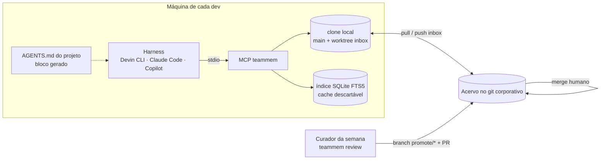

# Plano de implementação — memória compartilhada de time

> Documento de referência para implementar a memória compartilhada no **ambiente
> corporativo** (time de 4 pessoas). A implementação particular deste repositório
> serve de referência funcional; a versão corporativa deve seguir a
> [SPEC](SPEC.md), mas é construída e distribuída **dentro** da infraestrutura
> da empresa.

## 1. Objetivo

Dar aos agentes de código do time (Devin CLI, Claude Code e GitHub Copilot) uma
memória comum de **aprendizados**: decisões, armadilhas, convenções e padrões
descobertos no trabalho. A memória deve ser:

- **Compartilhada** entre pessoas, projetos e harnesses;
- **Curada**, com proveniência e revisão humana do que vira norma;
- **Viva**, com envelhecimento (`review_by`), expiração e substituição (`supersedes`);
- **Segura**, sem segredos e sem virar vetor de prompt injection.

**Fora de escopo:** estilo de código e procedimentos estáveis. Esses continuam
como skills e instruções versionadas nos próprios projetos.

## 2. Decisões já tomadas

| # | Decisão | Motivo |
|---|---|---|
| D1 | Fonte da verdade é um **repositório git de markdown** | Histórico, autoria, revisão e backup com a infraestrutura já aprovada; legível por humanos |
| D2 | Sem banco nem servidor central | Para 4 pessoas, o git cobre tudo; a latência (merge + pull) é aceitável para aprendizados |
| D3 | Acesso via **MCP local (stdio)** | Todos os harnesses do time rodam localmente e suportam MCP |
| D4 | **AGENTS.md** como canal estático, só com as memórias críticas | Denominador comum lido por todos os harnesses; o resto fica sob demanda via `search` |
| D5 | Escrita na branch **`inbox`** (sem proteção) | Só a `main` é protegida; o aprendizado circula na hora como *pendente* |
| D6 | Promoção **em lote**, com merge humano | Todo PR exige merge explícito, e não há conta de serviço: um clique por semana |
| D7 | Curadoria **local**, na máquina do curador da semana | Sem conta de serviço, o CI não pode fazer merge; o curador usa as próprias credenciais |
| D8 | Componente **separado** da orchestrated squad | Ciclo de vida e público próprios; a squad consome a memória como dependência |
| D9 | Compartilhar a **spec**, não o código, entre a versão particular e a corporativa | Repositórios git públicos não são permitidos no trabalho; evita problemas de PI |

## 3. Restrições do ambiente corporativo

| Restrição | Impacto no desenho |
|---|---|
| Não é permitido usar repositórios git públicos | Código, pacote, marketplace e acervo vivem no git e no registry internos |
| Todo PR na `main` exige merge explícito | Não existe auto-merge; promoção em lote semanal (D6) |
| Só a `main` é protegida | A branch `inbox` pode receber push direto (D5) |
| Contas de serviço com permissão de merge são inviáveis | O curador roda localmente e o merge é humano (D7) |
| Sem restrição de sensibilidade do conteúdo | CODEOWNERS simples; não há controle de acesso por escopo |

## 4. Arquitetura



### 4.1 Componentes

| Componente | Responsabilidade |
|---|---|
| **Acervo** (repositório de dados) | Memórias em markdown; `main` validada, `inbox` pendente; `.teammem.yaml` com a política; CODEOWNERS |
| **Pacote `teammem`** (Python) | MCP (stdio), CLI, curador determinístico, instalador multi-harness, gerador do bloco do AGENTS.md |
| **Clone local** (`~/.teammem/<acervo>/`) | `main/` (clone), `inbox/` (worktree da branch inbox), `index.sqlite`, fila offline |
| **Bloco no AGENTS.md** | Instrução de uso e memórias `pinned` |
| **Skill `/learn`** | Fluxo guiado para registrar um aprendizado (Claude Code e Devin CLI) |

### 4.2 Fluxos

**Leitura**
1. Na primeira chamada, o MCP clona o acervo e cria o worktree da `inbox`.
2. A cada chamada, com throttle de 10 minutos, faz `fetch` e fast-forward da main e `pull --rebase` da inbox.
3. Falhas de rede não bloqueiam a leitura: o MCP serve o que existe localmente.
4. O índice FTS5 é reconstruído quando o HEAD da main ou da inbox muda.

**Escrita (`propose`)**
1. Checagem de segurança: segredos e prompt injection recusam a proposta; URLs e comandos geram alertas.
2. Arquivo novo em `inbox/<id>.md`, commit com o autor e push na branch `inbox`.
3. Se o push colidir, faz `pull --rebase` e tenta de novo (não há conflito real, porque os arquivos são diferentes).
4. Sem rede, a proposta fica na fila local e é reenviada no próximo sync.

**Revisão semanal (curador da semana)**
1. `teammem review` (CLI) ou a tool `review_pending` (no harness) lista o lote com a classificação `auto`, `humano` ou `bloqueado`, os motivos e os similares.
2. O curador aprova item a item. No harness, o agente ajuda a deduplicar, consolidar e reescrever.
3. `promote` cria a branch `promote/<timestamp>` **a partir da main** só com os aprovados (`status: validated`) e abre o PR.
4. Outra pessoa do time aprova e faz o merge (CODEOWNERS).
5. `teammem gc` remove da inbox o que foi promovido e o que expirou (90 dias).

**Manutenção mensal**
- `teammem stale` lista memórias com `review_by` vencido, que são revalidadas, atualizadas ou substituídas.

## 5. Harnesses do time

| Harness | Leitura | Escrita | Config de MCP no projeto |
|---|---|---|---|
| Devin CLI | AGENTS.md + MCP | MCP `propose` + skill `/learn` | `.devin/mcp_config.json` (`mcpServers`) |
| Claude Code | AGENTS.md (via `@AGENTS.md` no CLAUDE.md) + MCP | MCP `propose` + skill `/learn` | `.mcp.json` (`mcpServers`) |
| GitHub Copilot (VS Code, agent mode) | AGENTS.md + MCP | MCP `propose` | `.vscode/mcp.json` (`servers`, `type: stdio`) |

O comando `teammem install --harness devin claude copilot` escreve as três
configurações de forma idempotente, copia a skill `/learn` e atualiza o
AGENTS.md. Se um arquivo de configuração tiver comentários (JSONC), o instalador
não sobrescreve: ele devolve o trecho para colar manualmente.

> ⚠️ Os formatos de configuração dessas ferramentas mudam com frequência.
> Valide cada um na versão em uso no time antes do rollout (Fase 1, tarefa 1.6).

## 6. Particular × trabalho

| Aspecto | Particular (este repositório) | Trabalho |
|---|---|---|
| Código | GitHub público | Git interno (implementação própria a partir da SPEC, ou adoção aprovada; ver §10) |
| Pacote | `uvx --from git+https://github.com/...` | Registry interno: `uvx --index <interno> --from teammem==X.Y.Z` |
| Acervo | GitHub privado | Git corporativo; só a `main` protegida |
| Curadoria | GitHub Actions: `review --auto` (auto direto na main, humano via PR) | Local, com o curador da semana: `review` → PR → merge humano |
| Política | `auto_scopes: [project, global]` | `auto_scopes: [project]`; o nível `auto` só sinaliza baixo risco no lote |
| Harnesses | Claude Code, Codex, OpenCode, Cursor | Devin CLI, Claude Code, Copilot |

**Regra de ouro:** nada é sincronizado automaticamente entre os dois acervos.
Um aprendizado genérico pode ser copiado manualmente (é só um arquivo `.md`).

## 7. Fases

Revisão incremental: cada fase termina com uma revisão do time antes de seguir.

### Fase 0 — Validações prévias (antes de escrever código)

| # | Tarefa | Responsável | Pronto quando |
|---|---|---|---|
| 0.1 | Confirmar a política de PI da empresa sobre código derivado de projeto pessoal open source | Rodrigo | Resposta por escrito: implementar do zero a partir da SPEC, ou adotar o pacote via mirror |
| 0.2 | Confirmar a plataforma de git e de CI (GitHub Enterprise, GitLab ou Azure DevOps) e a CLI para PRs (`gh` ou `glab`) | Rodrigo | Plataforma definida |
| 0.3 | Confirmar se há registry interno de pacotes Python com proxy do PyPI (`mcp`, `pyyaml`) | Rodrigo | URL do índice interno testada com `uv pip install mcp` |
| 0.4 | Confirmar que branches não protegidas permitem push de todos os membros | Rodrigo | Push de teste numa branch `inbox` |
| 0.5 | Validar o `uvx` nas máquinas do time (ou definir `pipx` como alternativa) | Time | Comando funcionando nas 4 máquinas |

### Fase 1 — Acervo + MCP de leitura e escrita

**Objetivo:** o time lendo e propondo memórias a partir dos três harnesses.

| # | Tarefa |
|---|---|
| 1.1 | Criar o repositório do acervo no git corporativo (`teammem init <dir> --profile work`): proteção da `main`, CODEOWNERS com os 4 membros |
| 1.2 | Popular o acervo com 10 a 20 memórias semente (armadilhas conhecidas do time), já via PR |
| 1.3 | Publicar o pacote no registry interno (build com `uv build`; versão fixa) |
| 1.4 | Implementar ou adotar: schema, store (clone, worktree inbox, sync com throttle, fila offline), índice FTS5, safety e o MCP com `list_index`, `read`, `search` e `propose` |
| 1.5 | `teammem install` para Devin CLI, Claude Code e Copilot, mais `teammem doctor` |
| 1.6 | **Validar o formato de config de MCP** de cada harness na versão em uso |
| 1.7 | Gerar o bloco do AGENTS.md nos projetos piloto (2 projetos) |

**Critérios de pronto**
- [ ] `doctor` passa nas 4 máquinas.
- [ ] Nos três harnesses, o agente encontra uma memória semente via `search`.
- [ ] Uma proposta feita no harness A aparece como *pendente* para outra pessoa no harness B em até 10 minutos.
- [ ] Uma proposta com um token falso é recusada.
- [ ] Sem rede, a leitura continua funcionando e a proposta vai para a fila.

### Fase 2 — Curadoria e promoção

**Objetivo:** ritual semanal de 15 minutos que mantém a inbox vazia.

| # | Tarefa |
|---|---|
| 2.1 | Curador determinístico: dedup (Jaccard), níveis `auto`/`humano`/`bloqueado`, política em `.teammem.yaml` |
| 2.2 | `review` (CLI interativa) e as tools `review_pending` e `promote` no MCP |
| 2.3 | Promoção: branch `promote/*` a partir da main, só com os aprovados; abertura de PR via `gh` ou `glab` |
| 2.4 | `gc` (remove promovidas e expiradas) e detecção de itens já em PR (`in_flight`) |
| 2.5 | Rodízio semanal do curador; o PR é aprovado por outra pessoa |
| 2.6 | `stale` + revisão mensal |

**Critérios de pronto**
- [ ] Duas semanas seguidas com a inbox zerada após a revisão.
- [ ] Tempo médio de revisão abaixo de 15 minutos por semana.
- [ ] Nenhum item promovido duas vezes (`in_flight` funcionando).

### Fase 3 — Captura e distribuição

| # | Tarefa |
|---|---|
| 3.1 | Skill `/learn` nos harnesses que suportam skills (Claude Code e Devin CLI) |
| 3.2 | Hooks de fim de sessão (Claude Code e Devin CLI) que **sugerem** candidatos ao usuário (nunca propõem sozinhos) |
| 3.3 | Empacotar como plugin no marketplace interno (Claude Code: repositório git interno; Devin: `.devin-plugin/`) |
| 3.4 | Integrar com a orchestrated squad do trabalho: agentes da squad chamam `search` no planejamento e `/learn` no fechamento |

### Fase 4 — Métricas e poda

| # | Tarefa |
|---|---|
| 4.1 | Tool `feedback(id, útil \| errada)`; memórias marcadas como erradas viram issue |
| 4.2 | Log local de uso (`search` com resultado, memória lida) e relatório mensal agregado |
| 4.3 | Poda: memórias nunca lidas em 6 meses entram na revisão; teto de `pinned` respeitado |
| 4.4 | Avaliar se a busca semântica é necessária (só se houver mais de cerca de 500 memórias ou se o FTS falhar em casos reais) |

## 8. Governança

- **CODEOWNERS:** `project/` pode ser aprovado por qualquer membro; `team/`, `org/`, `global/` e `.teammem.yaml` exigem os curadores (com 4 pessoas, provavelmente todos).
- **Curador da semana:** rodízio; executa `review` e abre o PR; outra pessoa aprova.
- **Critério de `pinned`:** sem gatilho, custo alto e abrangência (ver SPEC §5). Teto de 15; para entrar um item novo, outro precisa sair.
- **Escrita boa:** 2 a 6 linhas, com a fonte, dizendo o que fazer. Se não passar no teste "não óbvio, durável, acionável", não registre.
- **Conflitos:** uma memória nova que contradiz outra usa `supersedes`; a antiga sai da main no mesmo PR.

## 9. Segurança e riscos

| Risco | Mitigação |
|---|---|
| Segredo commitado numa memória | Checagem no `propose` (bloqueia) e de novo na curadoria; histórico git permite purga |
| Prompt injection via memória (afeta os agentes do time inteiro) | Heurísticas bloqueiam no `propose`; instruções do MCP e do AGENTS.md dizem que memória é dado; itens da inbox marcados como pendentes; merge humano na main |
| Qualquer pessoa com acesso de escrita pode escrever na inbox | Tudo da inbox é servido como "não revisado", com peso menor |
| Force-push apagando a inbox | O clone de cada membro serve de backup; proteger a inbox contra force-push, se a plataforma permitir sem exigir PR |
| Inbox crescendo sem revisão | TTL de 90 dias + rodízio + idade do lote visível no `review` |
| Memória desatualizada causando erro | `review_by`, `stale`, feedback (Fase 4), `supersedes` |
| AGENTS.md inchado | Teto de `pinned_max` com aviso no bloco gerado |
| Formatos de config dos harnesses mudam | Instalador centralizado + `doctor` + validação a cada atualização |

## 10. Propriedade intelectual e distribuição

Duas opções, a decidir na Fase 0 (tarefa 0.1):

1. **Implementação independente a partir da SPEC** (recomendada se houver dúvida):
   o código corporativo é escrito do zero no git interno, seguindo apenas a
   SPEC. A versão particular continua sendo só referência conceitual.
2. **Adoção do pacote open source** (se a política permitir): espelhar o
   `teammem` (licença MIT) no registry interno, com a versão fixada.

Em ambas, os requisitos de distribuição são os mesmos:
- **Nenhuma URL fixa no código:** acervo, índice de pacotes e marketplace vêm de configuração (`--repo`, `--source`, variáveis `TEAMMEM_*`).
- **Instalação offline possível:** `--source ./teammem-X.Y.Z-py3-none-any.whl`.
- **Versão fixada** nos adaptadores (`teammem==X.Y.Z`), para que uma atualização não quebre o time no meio da semana.

## 11. Perguntas em aberto

- [ ] Política de PI (0.1).
- [ ] Plataforma de git/CI e a CLI de PR disponível (0.2).
- [ ] Registry interno com proxy do PyPI (0.3).
- [ ] A plataforma permite bloquear force-push na `inbox` sem exigir PR?
- [ ] O time quer o hook de fim de sessão (Fase 3) ou só a skill `/learn`?

## Apêndice A — Comandos de referência

```bash
# Criar o acervo (uma vez)
teammem init team-memory --profile work

# Configurar um projeto (cada dev, em cada projeto)
teammem install --repo <url-git-interno-do-acervo> \
  --source "teammem==0.1.0" --harness devin claude copilot

# Diagnóstico
teammem doctor --repo <url>

# Uso manual
teammem search --repo <url> "timeout integração"
teammem propose --repo <url> --title "..." --type gotcha --body "..."

# Ritual semanal (curador)
teammem review --repo <url>             # interativo → PR
teammem review --repo <url> --list      # só lista
teammem gc --repo <url>                 # após o merge

# Mensal
teammem stale --repo <url>
teammem agents-md --repo <url>          # regenera o bloco do AGENTS.md
```

Dica: exporte `TEAMMEM_REPO` no shell para não repetir `--repo`.
